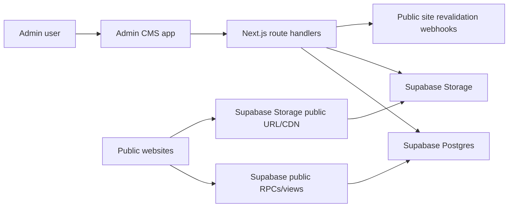
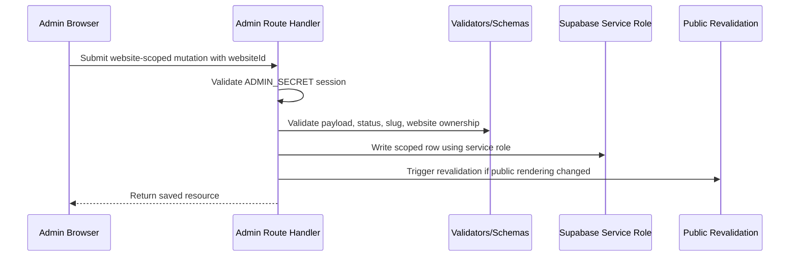
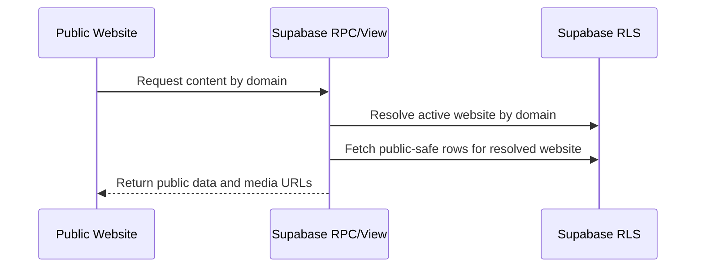
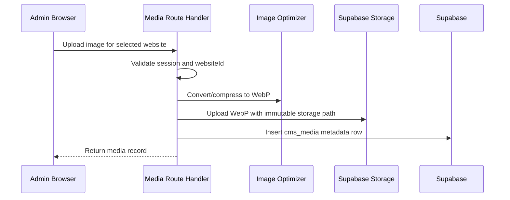
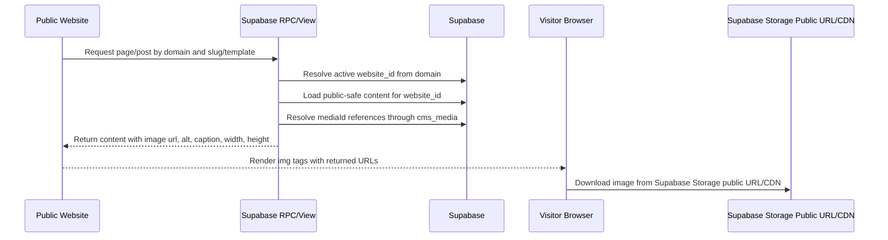
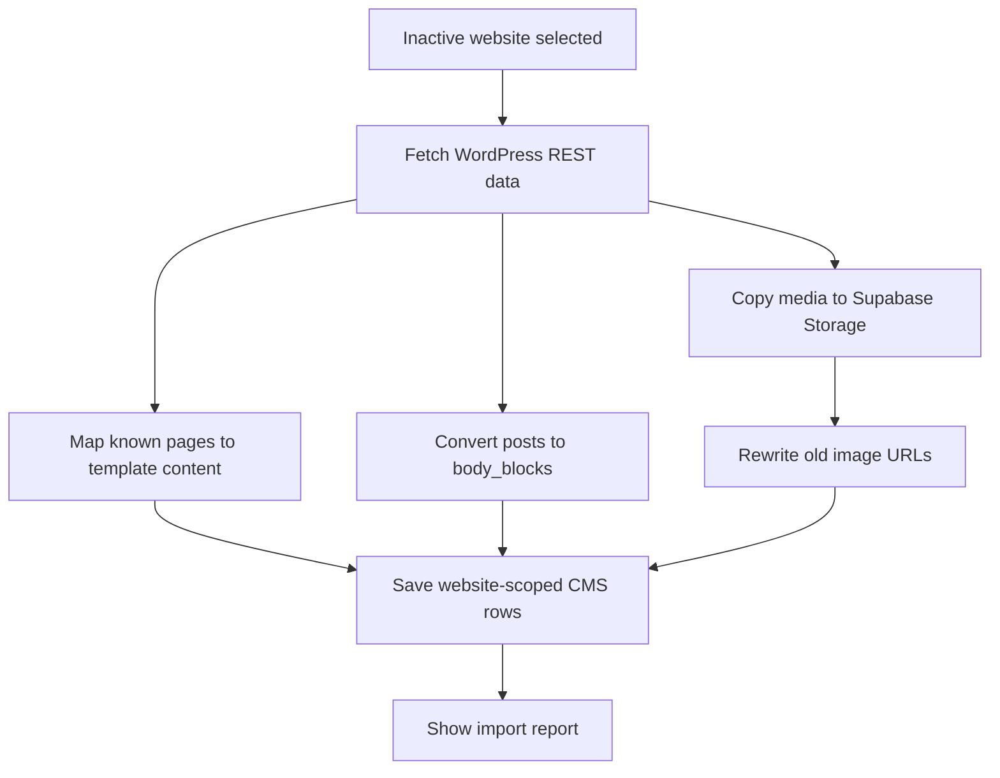

# CMS Architecture

## System Overview

The CMS is a separate Next.js admin app. It manages content and configuration for multiple separately deployed public websites.

Public websites do not use the admin app as a runtime backend. They read public-safe CMS data from Supabase using public read-only RPCs/views and render that data with their own existing code, layouts, and themes.



## Core Boundaries

Admin app responsibilities:

- authenticate the single admin with `ADMIN_SECRET`
- select website context after login
- create/edit/deactivate websites
- manage template content, posts, authors, categories, media, redirects, SEO, robots, sitemap settings, AdSense settings, and site settings
- run WordPress imports for inactive websites
- upload and delete media in Supabase Storage through server-only helpers
- trigger public website revalidation after public-facing changes
- keep global quiz behavior separate from selected website context

Public website responsibilities:

- resolve itself by domain through Supabase public RPCs/views
- fetch only public-safe CMS data for its resolved `website_id`
- render CMS data through existing layouts and components
- serve images from the configured Supabase Storage public URL/CDN
- render the AdSense script and `/ads.txt` only from safe website settings
- expose a server-only revalidation webhook

Supabase responsibilities:

- store CMS data and media metadata
- enforce ownership with `website_id`
- enforce public read safety with RLS and read-only RPCs/views
- keep service-role writes server-only

Supabase Storage responsibilities:

- store optimized WebP media files
- serve public images through Supabase Storage public URLs/CDN
- keep service-role storage writes server-only
- cache public image assets with Supabase Storage `cacheControl: '31536000'`

## Admin Write Flow



Rules:

- UI components never call Supabase or Supabase Storage directly.
- Route handlers call services/repositories.
- Repositories perform database access.
- Validators enforce schemas and ownership.
- Mutations always validate `website_id`.

## Public Read Flow



Rules:

- Public websites use anon credentials only.
- Public websites do not use admin APIs.
- Public websites do not upload, delete, or list Supabase Storage objects.
- Public websites receive media URLs from public read results.

## Media Flow



Permanent media delete checks all references first. If the media is unused, delete the Supabase Storage object and then hard delete the metadata row. If Supabase Storage deletion fails, keep the media row trashed and surface the error.

## Public Image Resolution Flow



Rules:

- Admin upload stores optimized WebP files in Supabase Storage under `websites/{website_id}/media/{yyyy}/{mm}/{uuid}.webp`.
- Uploaded public WebP images use Supabase Storage `cacheControl: '31536000'`.
- Supabase Storage image objects are immutable; replacing image content creates a new UUID storage path and updates CMS references.
- `cms_media` stores the website-scoped metadata, public URL, alt text, caption, dimensions, and Supabase Storage path.
- Template/post JSON stores `mediaId` as the stable internal reference.
- Public RPCs resolve `mediaId` references for the resolved `website_id` before returning data.
- Public responses return image objects with `url`, `alt`, `caption`, `width`, and `height`.
- Public websites do not receive Supabase service-role key and do not upload, delete, or list Supabase Storage objects.
- Visitor browsers download image bytes from the Supabase Storage public URL/CDN.
- Supabase Storage public URLs stay public/cacheable for website image assets.

## WordPress Import Flow



Import is blocked for active websites. Failed import reset clears only the inactive website's scoped data and imported Supabase Storage objects.

Import progress is tracked in `cms_import_jobs` so large WordPress imports can report progress and errors without relying on a single request response.

## Code Organization

Recommended structure:

```text
app/
  (admin)/admin/
  api/cms/
features/
  admin-shell/
  websites/
  import/
  template-content/
  posts/
  authors/
  media/
  redirects/
  settings/
  quiz/
lib/
  auth/
  supabase/
  storage/
  cms/
    repositories/
    validators/
    serializers/
    schemas/
supabase/
  migrations/
docs/
```

Feature modules should own UI and local feature behavior. Shared `lib/cms` code should stay narrow: repositories, validators, serializers, schema definitions, slug helpers, website context helpers, and public read helpers.

## Quiz Isolation

Quiz remains global:

- route: `/admin/quiz`
- no selected `website_id` required
- one quiz update applies to all public websites
- quiz code stays separate from website-scoped CMS modules
- visible quiz/page title uses the current Karachi date
- SEO/meta/schema date can roll over 6 hours early

Long term, quiz may move to Supabase, but it still remains global.
