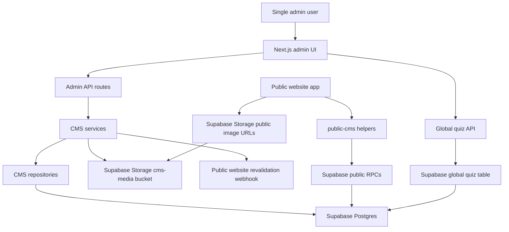

# CMS Implementation Details

This file documents the current implemented project after Milestones 1-13. Use it as a practical handoff map when reading, testing, debugging, or extending the code.

For product scope, read `PROJECT_PLAN.md`. For completed milestone history, read `MILESTONE_REVIEWS.md`. For exact API/data contracts, read `API_CONTRACTS.md` and `DATA_MODEL.md`.

## Current Implementation Status

Implemented:

- Single-admin login with signed admin session cookie.
- Server-side env validation.
- Basic admin login rate limiting.
- Supabase schema migrations for website-scoped CMS data.
- Supabase RLS and public-safe RPC contracts.
- Website create, select, edit, activate, and deactivate.
- Separate admin pages for each CMS resource.
- Website-scoped media upload to Supabase Storage.
- WebP image optimization through `sharp`.
- Media metadata, usage checks, trash/restore, and permanent delete behavior.
- Website-scoped template content for fixed public page templates.
- Website-scoped blog posts with structured body blocks.
- Website-scoped categories and authors.
- Website-scoped redirects.
- Website-scoped settings, SEO defaults, robots, sitemap config, AdSense config, and revalidation config.
- Inactive-website WordPress import with authors, fallback author, posts, categories, known template pages, media copy, and reset.
- Public website helper modules for later public repo integration.
- Global quiz admin page and API, separate from website-scoped CMS data.
- Milestone review documentation flow.
- Automated tests covering each milestone.

Deferred or caveated:

- Public website repo integration is prepared but not wired yet.
- Quiz persistence is Supabase-backed in `cms_global_quiz`.
- WordPress import is synchronous and currently limited to the first 100 records per source resource.
- Production release still needs manual browser QA against real Supabase data.

## Runtime Architecture



## Admin Pages

All admin pages use `AdminShell` and require the admin session before showing the workspace.

| Route | Purpose | Main UI module |
| --- | --- | --- |
| `/admin` | Empty dashboard landing page | `features/dashboard/DashboardWorkspace.jsx` |
| `/admin/add-website` | Website creation, selection, editing, activation, deactivation, and WordPress import | `features/websites/WebsitesWorkspace.jsx` |
| `/admin/media` | Website-scoped media library | `features/media/MediaWorkspace.jsx` |
| `/admin/content` | Fixed template/page content | `features/template-content/TemplateContentWorkspace.jsx` |
| `/admin/posts` | Blog posts | `features/posts/PostsWorkspace.jsx` |
| `/admin/categories` | Blog categories | `features/categories/CategoriesWorkspace.jsx` |
| `/admin/authors` | Blog authors | `features/authors/AuthorsWorkspace.jsx` |
| `/admin/redirects` | 301/302 redirects | `features/redirects/RedirectsWorkspace.jsx` |
| `/admin/settings` | SEO, robots, sitemap, AdSense, revalidation settings | `features/settings/SettingsWorkspace.jsx` |
| `/admin/quiz` | Global quiz management | `features/quiz/QuizManager.jsx` |

Website-scoped pages preserve `websiteId` in the query string when navigating between sections. Quiz and Add Website intentionally do not show the left sidebar. Website creation/editing/import UI belongs only to `/admin/add-website`; normal CMS pages should not render the website list, Add Website card, Selected Website edit card, or WordPress import form.

## App Route Layout

Admin UI pages:

```text
app/(admin)/admin/page.jsx
app/(admin)/admin/media/page.jsx
app/(admin)/admin/content/page.jsx
app/(admin)/admin/posts/page.jsx
app/(admin)/admin/categories/page.jsx
app/(admin)/admin/authors/page.jsx
app/(admin)/admin/redirects/page.jsx
app/(admin)/admin/settings/page.jsx
app/(admin)/admin/quiz/page.jsx
```

Admin API routes:

```text
app/api/admin/session/route.js
app/api/cms/websites/
app/api/cms/media/
app/api/cms/template-content/
app/api/cms/posts/
app/api/cms/categories/
app/api/cms/authors/
app/api/cms/redirects/
app/api/cms/settings/
app/api/cms/import/
app/api/quiz/route.js
```

Route handlers should stay thin. They validate admin session, parse payload/query input, call validators/services/repositories, and return the shared JSON/error shape.

## Feature Modules

Feature modules own browser UI and local screen state only.

```text
features/admin-shell/
features/websites/
features/media/
features/template-content/
features/posts/
features/categories/
features/authors/
features/redirects/
features/settings/
features/import/
features/quiz/
```

Important UI patterns:

- Website-scoped resource sections use `WebsiteContextShell`.
- Website management and WordPress import use `WebsiteSectionShell` only on `/admin/add-website`.
- Resource UI components receive `websiteId` from the selected website shell.
- Quiz UI is separate and does not receive `websiteId`.
- UI components call app API routes; they do not call Supabase directly.

## Library Modules

CMS modules are separated by responsibility:

```text
lib/cms/repositories/  database reads and writes
lib/cms/services/      multi-step workflows
lib/cms/validators/    payload and ownership validation
lib/cms/serializers/   response shaping
lib/cms/schemas/       structured content schemas
lib/cms/http/          shared API response/error helpers
lib/cms/crypto/        encryption helpers
```

Platform/support modules:

```text
lib/adminAuth.js
lib/auth/adminLoginRateLimit.js
lib/env/adminEnv.js
lib/supabase/adminRest.js
lib/storage/imageOptimizer.js
lib/storage/supabaseStorage.js
lib/public-cms/
lib/quiz/
```

## Website Scoping Rules

Website-scoped resources must always include or validate `websiteId`:

- template content
- posts
- categories
- authors
- media
- redirects
- settings
- import jobs

Rules:

- Admin API payloads/query params use `websiteId`.
- Database columns use `website_id`.
- Same slugs can exist across websites.
- Duplicate slugs are blocked inside one website where applicable.
- Cross-website media, author, category, and settings references are rejected.
- Public reads resolve the website from domain and return only that website's public-safe data.

Global resources:

- Quiz is global.
- Quiz must not add `website_id`.
- Quiz must not be filtered by selected website.

## Supabase Storage Implementation

The project uses one public Supabase Storage bucket:

```text
cms-media
```

Object path pattern:

```text
websites/{website_id}/media/{yyyy}/{mm}/{uuid}.webp
```

Upload flow:

1. Admin browser sends multipart upload to `/api/cms/media?websiteId=...`.
2. Server route validates admin session and selected website.
3. Server optimizes image to WebP with `sharp`.
4. Server uploads to Supabase Storage using server credentials.
5. Server stores metadata in `cms_media`.
6. Admin/public responses use `cms_media.public_url`.

Important constraints:

- Public websites never upload, delete, or list storage objects.
- Admin browser never receives service-role credentials.
- Existing public image objects are treated as immutable.
- Replacing an image creates a new UUID storage path.
- Permanent delete checks references first.
- If storage delete fails, the trashed media row is kept and an admin error is shown.

## Content Model

Template content:

- Fixed template keys such as home, about, contact, privacy, terms, and packages.
- Stored in `cms_template_content`.
- Uses structured `content_data`.
- Images are referenced by `mediaId`.
- Public RPCs resolve image IDs to image objects.

Blog posts:

- Stored in `cms_posts`.
- Require one same-website `author_id`.
- May use one same-website category.
- Store structured `body_blocks`.
- Supported blocks include paragraph, heading, image, list, quote, link/button, TOC placeholder, FAQ, table, and callout.
- Images are referenced by `mediaId`.

Authors:

- Stored in `cms_authors`.
- Website-scoped profile records only.
- No author login in v1.
- Avatar must be same-website media when present.

Categories:

- Stored in `cms_categories`.
- Website-scoped.
- Tags are intentionally not included in v1.

## SEO, Redirects, Settings, And AdSense

Settings are website-scoped and stored in `cms_site_settings`.

Included setting areas:

- SEO defaults.
- robots.txt content.
- sitemap settings.
- AdSense settings.
- Revalidation webhook URL and encrypted secret.

AdSense behavior:

- Default is inactive for new websites.
- Enabling AdSense requires a valid `ca-pub-...` publisher ID.
- Disabling AdSense keeps saved values but public output becomes inactive.
- Public safe settings expose only safe AdSense fields.
- Public websites should render AdSense script only when safe settings say it is enabled and configured.
- `/ads.txt` should exist only when AdSense is active and `adsTxt` content exists.

Redirect behavior:

- Supports 301 and 302.
- Duplicate source paths are blocked per website.
- Loops are rejected.
- Public reads return only active, non-trashed redirects.

## WordPress Import

Import is an inactive-website setup workflow.

Input:

- Selected inactive `websiteId`.
- WordPress base URL.
- Optional WordPress username.
- Optional WordPress application password.

Behavior:

- Creates/updates `cms_import_jobs`.
- Fetches WordPress posts, pages, categories, users, and media.
- Imports authors before posts when possible.
- Creates or reuses fallback author `Imported Author` if author data is missing.
- Never imports posts without `author_id`.
- Maps known WordPress pages to template content.
- Converts basic HTML to structured content/body blocks.
- Copies images into Supabase Storage.
- Rewrites old WordPress image URLs to Supabase Storage public URLs where possible.
- Clears temporary credentials after import success/failure.

Reset behavior:

- Reset is allowed only for inactive websites.
- Reset deletes imported rows and imported storage objects for that website.
- Reset does not delete manually uploaded media objects.

Known limits:

- Import is synchronous.
- First 100 records per resource are handled in v1.
- Complex WordPress builders, shortcodes, galleries, tables, embeds, and plugin SEO metadata may need future support.

## Public Website Integration

The admin CMS repo includes helper modules, but the real public website repo is not wired yet.

Helper modules:

```text
lib/public-cms/client.js
lib/public-cms/adsense.js
lib/public-cms/revalidation.js
lib/public-cms/sitemap.js
lib/public-cms/index.js
```

Public website rules:

- Use Supabase anon key only.
- Call public RPCs/views only.
- Do not call admin API routes.
- Do not use service-role key.
- Do not upload/delete/list Supabase Storage objects.
- Render returned image URLs directly.
- Render AdSense only from safe public settings.
- Protect revalidation endpoint with `CMS_REVALIDATION_SECRET`.

See `public-site-integration/README.md` before wiring the first public website.

## Quiz Implementation

Quiz is intentionally separate from website-scoped CMS resources.

Files:

```text
app/(admin)/admin/quiz/page.jsx
app/api/quiz/route.js
features/quiz/QuizManager.jsx
lib/quiz/state.js
lib/quiz/validators.js
```

Behavior:

- Requires admin session.
- Does not require selected website.
- Does not accept or return `websiteId`.
- One global quiz update applies to all websites.
- Stores only current quiz questions, publish state, and update timestamp in `cms_global_quiz`.
- Public websites read the published quiz through `cms_public_get_current_quiz()`.
- Quiz table does not store title, slug, description, visible date, SEO date, or page metadata.
- Homepage/page SEO is managed by website template/settings data.

## Environment Variables

Admin CMS required:

```text
ADMIN_SECRET
NEXT_PUBLIC_SUPABASE_URL
SUPABASE_SERVICE_ROLE_KEY
CMS_ENCRYPTION_KEY
```

Public websites required later:

```text
NEXT_PUBLIC_SUPABASE_URL
NEXT_PUBLIC_SUPABASE_ANON_KEY
CMS_REVALIDATION_SECRET
```

No per-website `.env` variables are required for CMS website creation. Websites are database records.

No AdSense `.env` variable is required. AdSense is website-level database configuration.

No Cloudflare R2 variables are used. Media uses Supabase Storage.

## Supabase Files

Migrations live under:

```text
supabase/migrations/
```

Expected migration concerns:

- CMS tables and indexes.
- RLS policies.
- Public RPCs.
- Storage bucket setup.
- Admin service-role grants.
- Media usage helpers.
- Website/admin transactional helper functions.

When adding future migrations:

- Keep RLS enabled.
- Do not expose admin-only tables to anon.
- Preserve website scoping.
- Add service-role grants where needed.
- Add tests for SQL contract changes.

## Test Coverage

Milestone tests live in:

```text
test/
```

Current test themes:

- Docs readiness.
- Admin env validation and login rate limiting.
- Schema/migration contracts.
- RLS/public RPC safety.
- Website management.
- Media optimization/storage.
- Categories/authors.
- Template content.
- Posts.
- Redirects/settings/AdSense/revalidation.
- WordPress import.
- Public integration helpers.
- Quiz isolation.
- Final hardening/admin page separation.

Standard validation commands:

```powershell
npm.cmd test
npm.cmd run lint
npm.cmd run build
git diff --check -- docs app lib features test supabase package.json package-lock.json .env.example tailwind.config.js
```

## Manual QA Checklist

Before production use, manually verify:

- Login with valid and invalid `ADMIN_SECRET`.
- Website create/select/edit/activate/deactivate.
- Navigation between admin sections keeps selected website.
- Media upload creates WebP image and public URL.
- Media trash/restore/permanent delete behavior.
- Template content save/publish/unpublish/trash/restore/delete.
- Post create/save/publish/unpublish/trash/restore/delete.
- Author/category create/edit/trash/restore/delete behavior.
- Cross-website media/author/category references are rejected.
- Redirect duplicate/loop validation.
- Settings save, especially AdSense validation and revalidation config.
- WordPress import on an inactive website.
- WordPress import reset on an inactive website.
- Quiz updates without selecting a website.
- Public RPCs return only public-safe data.
- Public website integration once the public repo is wired.

## Remaining Production Decisions

These are not blockers for the current admin CMS rebuild, but they matter before real release:

- Public website repo wiring and end-to-end rendering.
- Background/paginated WordPress import for large sites.
- Final UX polish for rich editors and media picking.
- Deployment target and environment variable setup.
- Manual QA with real data and real domains.
