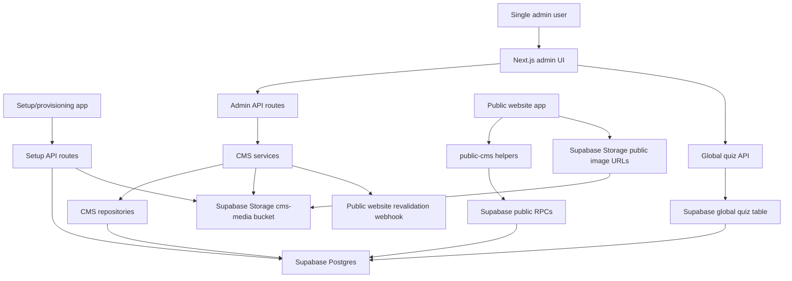

# CMS Implementation Details

This file documents the current implemented project after Milestones 1-13. Use it as a practical handoff map when reading, testing, debugging, or extending the code.

For product scope, read `PROJECT_PLAN.md`. For completed milestone history, read `MILESTONE_REVIEWS.md`. For exact API/data contracts, read `API_CONTRACTS.md` and `DATA_MODEL.md`.

## Global quiz revalidation follow-up (2026-07-18)

Unlike website-scoped content, `cms_global_quiz` affects every active public
website. `app/api/quiz` now saves the quiz and then uses
`triggerRevalidationForActiveWebsites`. Each active website receives its own
webhook request with `global_quiz.updated` and the homepage, page sitemap, and
sitemap-index paths. The result reports one entry per active website so an
administrator can see a failed endpoint without losing the quiz save.

## Current Implementation Status

Implemented:

- Home manual HTML resolves `{date}` in its H1 and daily quiz H2 with the visible Karachi date before the table of contents and quiz split are rendered. Home metadata, WebPage JSON-LD, and the Home sitemap freshness timestamp use a Karachi date six hours ahead.
- Public metadata honors optional CMS canonical URL, robots meta, and OG image values while retaining generated defaults when fields are blank.
- Public sitemap generation canonicalizes fixed-page aliases, removes duplicate entries, and excludes legacy home/404 CMS paths.
- Public redirect middleware performs one anon-safe exact redirect lookup rather than retrieving the full redirect list.
- Posts and Page/Template editors show a non-blocking content-quality panel for image alt text, links, headings, SEO field quality, focus keyphrase, and Home date placeholder use.

- Single-admin login with signed admin session cookie.
- Server-side env validation.
- Basic admin login rate limiting.
- Supabase schema migrations are owned by `setup-provisioning/`.
- Supabase RLS and public-safe RPC contracts.
- Website selection from existing provisioned websites.
- Separate admin pages for each CMS resource.
- Website-scoped media upload to Supabase Storage.
- WebP image optimization through `sharp`.
- Media metadata, usage checks, and permanent delete behavior.
- Media Library table search filters automatically while typing, and bulk delete calls the existing safe permanent delete endpoint per selected row.
- Website-scoped template content for fixed public page templates.
- Website-scoped blog posts with Tiptap `body_html` as the preferred body format and structured `body_blocks` as legacy/import fallback.
- Website-scoped categories and authors.
- Website-scoped redirects.
- Website-scoped settings, SEO defaults, robots, sitemap config, AdSense config, and revalidation config.
- WordPress import is owned by `setup-provisioning/`.
- Public website helper modules for later public repo integration.
- Global quiz admin page and API, separate from website-scoped CMS data.
- Milestone review documentation flow.
- Automated tests covering each milestone.
- Home template rich content validation, including sanitized HTML and keyed repeatable sections.
- Public post pagination, author, category-count, and sitemap-index RPCs.
- Reference public site migration in a local `lib/cms/` facade with domain-scoped five-minute cache tags.
- CMS-backed homepage/quiz, pages, posts, categories, authors, redirects, robots, sitemaps, ads.txt, and AdSense behavior in the reference frontend.
- Client-only AdSense settings context is consumed only by explicit Client Components, preserving Server Component rendering for public routes.
- Public route guards for templates, custom pages, and categories.
- WordPress imports preserve legacy fixed-page routes (`/about-us`, `/contact-us`, and `/privacy-policy`) as fixed template paths. Migration `202607150001_preserve_fixed_page_legacy_paths.sql` repairs those routes for websites imported before this correction.
- Content records are publish-only: Posts, Pages, and Templates have no content status field. Migration `202607150003_reconcile_publish_only_content.sql` reconciles older schemas/public RPCs that reintroduced draft-status predicates and also repairs historic fixed-page imports.
- Sitemap URLs resolve through the CMS request-domain helper, including the `/blog` archive entry, so local/preview sitemap hosts cannot leak the production domain.

Deferred or caveated:

- Public website repo integration is prepared but not wired yet.
- Quiz persistence is Supabase-backed in `cms_global_quiz`.
- Setup/provisioning workflows, including WordPress import, are outside the main CMS app.
- Production release still needs manual browser QA against real Supabase data.
- The new migrations are intentionally unexecuted until the selected migration environment is ready; compare `docs/migration-baseline.md` before activation.
- The Home seed script accepts either `SUPABASE_URL` or the existing `NEXT_PUBLIC_SUPABASE_URL`, plus server-only `SUPABASE_SERVICE_ROLE_KEY` and `CMS_SITE_DOMAIN`. It is dry-run by default, refuses an active website, and can create the missing fixed Home template during explicit `--apply` execution.
- Local frontend validation confirms CMS-backed homepage, blog, search, robots, and sitemap routes. Fixed/custom pages and category routes return 404 until their content is imported or provisioned; `ads.txt` returns 404 while CMS AdSense is disabled.

## WordPress-To-Supabase Reference Implementation

The reference public application keeps adapters in `lib/cms/index.js`, revalidation validation in `lib/cms/revalidation.js`, CMS-driven sitemap rendering in `lib/sitemap.js`, and redirect resolution in `middleware.js`. It uses the anon RPC endpoint only; its WordPress clients, old quiz admin routes, tag archive route, static ads.txt, and WordPress maintenance scripts were removed. The frontend passes `npm.cmd test`, `npm.cmd run lint`, and `npm.cmd run build` before staging configuration is applied.

## Runtime Architecture



`setup-provisioning/` is the schema/onboarding owner. The main CMS is a schema consumer for daily content editing.

## Admin Pages

All admin pages use `AdminShell` and require the admin session before showing the workspace.

| Route | Purpose | Main UI module |
| --- | --- | --- |
| `/admin` | Selected-website dashboard with content counts and shared CMS Storage usage | `features/dashboard/DashboardWorkspace.jsx` |
| `/admin/media` | Website-scoped media library | `features/media/MediaWorkspace.jsx` |
| `/admin/content` | Fixed template/page content | `features/template-content/TemplateContentWorkspace.jsx` |
| `/admin/posts` | Blog posts | `features/posts/PostsWorkspace.jsx` |
| `/admin/categories` | Blog categories | `features/categories/CategoriesWorkspace.jsx` |
| `/admin/authors` | Blog authors | `features/authors/AuthorsWorkspace.jsx` |
| `/admin/redirects` | 301/302 redirects | `features/redirects/RedirectsWorkspace.jsx` |
| `/admin/settings` | SEO, robots, sitemap, AdSense, revalidation settings | `features/settings/SettingsWorkspace.jsx` |
| `/admin/quiz` | Global quiz management | `features/quiz/QuizManager.jsx` |

Website-scoped pages preserve `websiteId` in the query string when navigating between sections. Quiz intentionally does not show the left sidebar. Website creation/editing/import UI belongs to `setup-provisioning/`; normal CMS pages should not render the website list, Add Website card, Selected Website edit card, or WordPress import form.

Media Library specifics:

- The media table includes checkbox selection, an automatic search input, and a bulk permanent delete toolbar.
- Bulk delete loops through the existing media `DELETE` API route for each selected item.
- The `Usage` action stays in the row `Actions` column and calls the existing usage endpoint.
- Referenced media remains protected by server-side usage checks.

## App Route Layout

Admin UI pages:

```text
app/(admin)/admin/page.jsx
app/(admin)/admin/media/page.jsx
app/(admin)/admin/content/page.jsx
app/(admin)/admin/posts/page.jsx
app/(admin)/admin/categories/page.jsx
app/(admin)/admin/authors/page.jsx
app/(admin)/admin/redirects/page.jsx
app/(admin)/admin/settings/page.jsx
app/(admin)/admin/quiz/page.jsx
```

Admin API routes:

```text
app/api/admin/session/route.js
app/api/cms/websites/   read-only website listing/detail for CMS selection
app/api/cms/media/
app/api/cms/template-content/
app/api/cms/posts/
app/api/cms/categories/
app/api/cms/authors/
app/api/cms/redirects/
app/api/cms/settings/
app/api/quiz/route.js
```

Route handlers should stay thin. They validate admin session, parse payload/query input, call validators/services/repositories, and return the shared JSON/error shape.

## Feature Modules

Feature modules own browser UI and local screen state only.

```text
features/admin-shell/
features/media/
features/template-content/
features/posts/
features/categories/
features/authors/
features/redirects/
features/settings/
features/quiz/
```

Important UI patterns:

- Website-scoped resource sections use `WebsiteContextShell`.
- Website management and WordPress import live in `setup-provisioning/`.
- Resource UI components receive `websiteId` from the selected website shell.
- Quiz UI is separate and does not receive `websiteId`.
- UI components call app API routes; they do not call Supabase directly.

## Library Modules

Shared CMS modules live in the local `cms-core` workspace package and are separated by responsibility:

```text
packages/cms-core/cms/repositories/  database reads and writes
packages/cms-core/cms/services/      multi-step workflows
packages/cms-core/cms/validators/    payload and ownership validation
packages/cms-core/cms/serializers/   response shaping
packages/cms-core/cms/schemas/       structured content schemas
packages/cms-core/cms/http/          shared API response/error helpers
packages/cms-core/cms/crypto/        encryption helpers
```

Platform/support modules:

```text
packages/cms-core/adminAuth.js
packages/cms-core/auth/adminLoginRateLimit.js
packages/cms-core/env/adminEnv.js
packages/cms-core/supabase/adminRest.js
packages/cms-core/storage/imageOptimizer.js
packages/cms-core/storage/supabaseStorage.js
packages/cms-core/public-cms/
packages/cms-core/quiz/
```

Both the main Admin CMS and `setup-provisioning/` import these helpers through `cms-core/...`. The package is bundled into each app at build time and is not deployed separately.

## Website Scoping Rules

Website-scoped resources must always include or validate `websiteId`:

- template content
- posts
- categories
- authors
- media
- redirects
- settings
- import jobs

Rules:

- Admin API payloads/query params use `websiteId`.
- Database columns use `website_id`.
- Same slugs can exist across websites.
- Duplicate slugs are blocked inside one website where applicable.
- Cross-website media, author, category, and settings references are rejected.
- Public reads resolve the website from domain and return only that website's public-safe data.

Global resources:

- Quiz is global.
- Quiz must not add `website_id`.
- Quiz must not be filtered by selected website.

## Supabase Storage Implementation

The project uses one public Supabase Storage bucket:

```text
cms-media
```

Object path pattern:

```text
websites/{website_id}/media/{yyyy}/{mm}/{filename}.webp
```

Upload flow:

1. Admin browser sends multipart upload to `/api/cms/media?websiteId=...`.
2. Server route validates admin session and selected website.
3. Server optimizes image to WebP with `sharp`.
4. Server uploads to Supabase Storage using server credentials.
5. Server stores metadata in `cms_media`.
6. Admin/public responses use `cms_media.public_url`.

Important constraints:

- Public websites never upload, delete, or list storage objects.
- Admin browser never receives service-role credentials.
- Existing public image objects are treated as immutable.
- Replacing an image creates a new readable filename path with a numeric collision suffix.
- Permanent delete checks references first.
- If storage delete fails, the media metadata row is kept and an admin error is shown.

## Content Model

Template content:

- Fixed template keys such as home, about, contact, privacy, terms, and packages.
- Stored in `cms_template_content`.
- Uses structured `content_data`.
- Images are referenced by `mediaId`.
- Public RPCs resolve image IDs to image objects.

Custom pages:

- Stored in `cms_pages`.
- Website-scoped WordPress-style page records.
- Created by the Pages admin `Add Page` action.
- Do not use `template_key` and must not replace fixed template rows.
- Use `body_text` to store the current sanitized page editor HTML.
- Public reads use `get_public_page(domain, page_path)`.
- Sitemap includes published rows with `sitemap_include = true`.

Blog posts:

- Stored in `cms_posts`.
- Require one same-website `author_id`.
- Require one same-website category for new saves because public post URLs use `/{categorySlug}/{postSlug}`.
- Store new admin edits as sanitized Tiptap `body_html`.
- Keep structured `body_blocks` for backward compatibility and imported legacy content.
- Public sites should prefer `body_html` when present and fall back to `body_blocks`.
- Images in editor HTML are referenced with `data-media-id`; legacy blocks reference images by `mediaId`.

Authors:

- Stored in `cms_authors`.
- Website-scoped profile records only.
- No author login in v1.
- Avatar must be same-website media when present.

Categories:

- Stored in `cms_categories`.
- Website-scoped.
- Tags are intentionally not included in v1.

## SEO, Redirects, Settings, And AdSense

Settings are website-scoped and stored in `cms_site_settings`.

Included setting areas:

- SEO defaults.
- robots.txt content.
- sitemap settings.
- AdSense settings.
- Revalidation webhook URL and encrypted secret.

AdSense behavior:

- Default is inactive for new websites.
- Enabling AdSense requires a valid `ca-pub-...` publisher ID.
- Disabling AdSense keeps saved values but public output becomes inactive.
- Public safe settings expose only safe AdSense fields.
- Public websites should render AdSense script only when safe settings say it is enabled and configured.
- `/ads.txt` should exist only when AdSense is active and `adsTxt` content exists.

Redirect behavior:

- Supports 301 and 302.
- Duplicate source paths are blocked per website.
- Loops are rejected.
- Public reads return only active redirects.

## WordPress Import

Import is an inactive-website setup workflow owned by `setup-provisioning/`, not the main Admin CMS.

Input:

- Selected inactive `websiteId`.
- WordPress base URL.
- Optional WordPress username.
- Optional WordPress application password.

Behavior:

- Creates/updates `cms_import_jobs`.
- Fetches WordPress posts, pages, categories, users, and media.
- Imports authors before posts when possible.
- Normalizes WordPress user descriptions into website-scoped author bios, stripping markup and limiting the value to 2,000 characters.
- Creates or reuses fallback author `Imported Author` if author data is missing.
- Never imports posts without `author_id`.
- Creates or reuses fallback category `Uncategorized` if category data is missing.
- Maps known WordPress pages to template content.
- Imports unmatched WordPress pages into `cms_pages` when safe, otherwise reports them as skipped.
- Converts basic HTML to template content and either `body_html` or compatible fallback body blocks for posts.
- Uses an import-only mapper for SEO and image fields: missing SEO values and featured images remain `null`, and present meta descriptions are capped at 300 characters.
- Uses Yoast-first SEO mapping: Focus keyphrase comes from `cms_yoast.focusKeyphrase`; SEO title uses `cms_yoast.seoTitle`, then `yoast_head_json.title`, then the WordPress title; meta description uses Yoast values and remains empty when no Yoast description is available. WordPress excerpts are not stored or used as post metadata.
- The setup project includes `wordpress/cms-yoast-rest-bridge.php`, which exposes the Yoast raw fields needed for Focus keyphrase import.
- Does not use the normal manual Page/Post required-field validators for imported SEO or featured-image fields; service-level ownership, duplicate, author, category, and inline-media checks still apply.
- Fetches WordPress resource collections with automatic 100-item pagination, using response totals when available and short-batch termination otherwise.
- Keeps the first successful REST route format for subsequent pages and enforces a maximum page safety limit.
- Copies images into Supabase Storage.
- Rewrites old WordPress image URLs to Supabase Storage public URLs where possible.
- Preserves safe HTML in imported Posts and custom Pages, including links, tables, formatting, and supported embeds.
- Rewrites links for the WordPress source or selected website domain to relative CMS paths; external links stay unchanged.
- Clears temporary credentials after import success/failure.

Reset behavior:

- Reset is allowed only for inactive websites.
- Reset deletes imported rows and imported storage objects for that website.
- Reset does not delete manually uploaded media objects.

Known limits:

- Import is synchronous.
- Resource collections are fetched automatically in 100-record pages until all available records are imported.
- Complex WordPress builders, shortcodes, galleries, tables, embeds, and plugin SEO metadata may need future support.

## Public Website Integration

The admin CMS repo includes helper modules, but the real public website repo is not wired yet.

Helper modules:

```text
packages/cms-core/public-cms/client.js
packages/cms-core/public-cms/adsense.js
packages/cms-core/public-cms/revalidation.js
packages/cms-core/public-cms/sitemap.js
packages/cms-core/public-cms/index.js
```

Public website rules:

- Use Supabase anon key only.
- Call public RPCs/views only.
- Do not call admin API routes.
- Do not use service-role key.
- Do not upload/delete/list Supabase Storage objects.
- Render returned image URLs directly.
- Render AdSense only from safe public settings.
- Protect revalidation endpoint with `CMS_REVALIDATION_SECRET`.

See `public-site-integration/README.md` before wiring the first public website.

## Quiz Implementation

Quiz is intentionally separate from website-scoped CMS resources.

Files:

```text
app/(admin)/admin/quiz/page.jsx
app/api/quiz/route.js
features/quiz/QuizManager.jsx
lib/quiz/state.js
lib/quiz/validators.js
```

Behavior:

- Requires admin session.
- Does not require selected website.
- Does not accept or return `websiteId`.
- One global quiz update applies to all websites.
- Stores only current quiz questions, publish state, and update timestamp in `cms_global_quiz`.
- Public websites read the published quiz through `cms_public_get_current_quiz()`.
- Quiz table does not store title, slug, description, visible date, SEO date, or page metadata.
- Homepage/page SEO is managed by website template/settings data.

## Environment Variables

Admin CMS required:

```text
ADMIN_SECRET
NEXT_PUBLIC_SUPABASE_URL
SUPABASE_SERVICE_ROLE_KEY
CMS_ENCRYPTION_KEY
```

Public websites required later:

```text
NEXT_PUBLIC_SUPABASE_URL
NEXT_PUBLIC_SUPABASE_ANON_KEY
CMS_REVALIDATION_SECRET
```

No per-website `.env` variables are required for CMS website creation. Websites are database records.

No AdSense `.env` variable is required. AdSense is website-level database configuration.

No Cloudflare R2 variables are used. Media uses Supabase Storage.

## Supabase Files

Migrations live under the setup/provisioning project:

```text
setup-provisioning/supabase/migrations/
```

Expected migration concerns:

- CMS tables and indexes.
- RLS policies.
- Public RPCs.
- Storage bucket setup.
- Admin service-role grants.
- Media usage helpers.
- Website/admin transactional helper functions.

When adding future migrations:

- Keep RLS enabled.
- Do not expose admin-only tables to anon.
- Preserve website scoping.
- Add service-role grants where needed.
- Add tests for SQL contract changes.
- Add the migration in `setup-provisioning/`; the main Admin CMS consumes the resulting schema but does not own migrations.

## Test Coverage

Milestone tests live in:

```text
test/
```

Current test themes:

- Docs readiness.
- Admin env validation and login rate limiting.
- Schema/migration contracts.
- RLS/public RPC safety.
- Website management.
- Media optimization/storage.
- Categories/authors.
- Template content.
- Posts.
- Redirects/settings/AdSense/revalidation.
- WordPress import.
- Public integration helpers.
- Quiz isolation.
- Final hardening/admin page separation.

Standard validation commands:

```powershell
npm.cmd test
npm.cmd run lint
npm.cmd run build
git diff --check -- docs app lib features test setup-provisioning supabase package.json package-lock.json .env.example tailwind.config.js
```

## Manual QA Checklist

Before production use, manually verify:

- Login with valid and invalid `ADMIN_SECRET`.
- Website create/edit/activate/deactivate/permanent deletion in `setup-provisioning/`. Permanent deletion is inactive-only and removes the website Storage prefix plus all website-scoped database rows.
- Website selection in the main Admin CMS header.
- Navigation between admin sections keeps selected website.
- Media upload creates WebP image and public URL.
- Media permanent delete behavior.
- Template content save/delete behavior.
- Post create/save/delete behavior.
- Author/category create/edit/delete behavior.
- Cross-website media/author/category references are rejected.
- Redirect duplicate/loop validation.
- Settings save, especially AdSense validation and revalidation config.
- WordPress import on an inactive website in `setup-provisioning/`.
- WordPress import reset on an inactive website in `setup-provisioning/`.
- Quiz updates without selecting a website.
- Public RPCs return only public-safe data.
- Public website integration once the public repo is wired.

## Remaining Production Decisions

These are not blockers for the current admin CMS rebuild, but they matter before real release:

- Public website repo wiring and end-to-end rendering.
- Background/paginated WordPress import for large sites.
- Final UX polish for rich editors and media picking.
- Deployment target and environment variable setup.
- Manual QA with real data and real domains.

## Local CMS domain resolver — 2026-07-16

- `lib/cmsDomain.js` centralizes hostname normalization and local/preview fallback behavior.
- `lib/cms/index.js` uses it before every public Supabase RPC, while `middleware.js` uses the same result before loading redirect rules.
- With `CMS_SITE_DOMAIN` set, `localhost`, `127.0.0.1`, and IPv6 loopback all resolve the selected local website; real custom domains continue to select by their request host.

## Homepage editor rendering follow-up — 2026-07-16

- `app/page.jsx` splits Home editor HTML around the manual `Today Telenor Answer...` heading, so the global Quiz CMS cards remain below that heading and before the six-card Latest News grid.
- `lib/homeContent.js` adds duplicate-safe anchors to editor H1–H4 elements and returns matching Table-of-Contents data. It also suppresses only the leading imported legacy Latest News heading/Explore-link pair because the dynamic grid supplies that UI.
- `components/posts/TableOfContents.jsx` is a collapsed, keyboard-accessible control styled to match the public homepage panel.
- `styles/globals.css` contains the scoped `.homepage-content` design system: responsive H1–H4 sizes, 15px reading text, navy headings, orange links/list markers, and responsive image/table rules. These rules do not alter normal post or page editor output.

## Homepage and sidebar post display follow-up — 2026-07-16

- `app/page.jsx` loads the newest 30 public post cards but still passes `limit={6}` to `LatestNewsGrid`.
- `LatestNewsGrid` keeps a deterministic server render, then retains the two newest cards in positions 1 and 2 and selects four unique cards from the remaining newest-30 pool after client hydration. This provides a fresh lower four-card selection on a full browser refresh without a hydration warning.
- `Sidebar.jsx` keeps records 1–5 as newest-first Recent Posts and supplies records 6–30 to `PopularPosts`.
- `PopularPosts.jsx` is client-side for the same hydration-safe rotation. It displays five unique cards under the label **Popular Posts**; it does not claim analytics popularity.
- The frontend deliberately does not sort archive responses. The public `list_public_posts_page` RPC remains responsible for `published_at DESC NULLS LAST, created_at DESC`, which keeps Blog and category archives newest-first.

## WordPress publication-date preservation follow-up — 2026-07-17

- `normalizeWordPressItem` normalizes the source `date_gmt` (or `date`) to a UTC ISO timestamp.
- Imported posts pass that timestamp into the repository, so `cms_posts.published_at` reflects the original WordPress publication date.
- Normal CMS post edits no longer overwrite `published_at`; newly created CMS posts still receive the current time.
- `setup-provisioning/scripts/repair-wordpress-post-dates.mjs` repairs already imported dates by matching source and CMS records by slug. It is dry-run by default, updates only `published_at` with `--apply`, and invokes the selected website's existing revalidation webhook.

## Public post-card reading-time follow-up — 2026-07-17

- `202607170001_public_post_reading_time.sql` adds `readingTimeMinutes` to the existing safe, paginated `list_public_posts_page` response. It counts visible CMS article words at 200 words per minute without returning `bodyHtml` to archive, Home, search, or sidebar cards.
- The reference frontend preserves that response in `lib/cms/index.js` and `PostMeta.jsx` prefers it over the local word-count fallback. Detail pages continue to calculate from their already available full post body if a list value is absent.

## Header current-menu state follow-up — 2026-07-17

- `HeaderNavigation.jsx` is a small client component that obtains the route path with `usePathname()` and gives the matching desktop and mobile menu link a filled primary button style plus `aria-current="page"`.
- Category post routes keep their category menu selected; Home remains selected only for `/`. Contact and About links are unchanged.

## Custom CMS Page presentation and canonical-override follow-up (2026-07-18)

- The dynamic custom-Page branch now reuses the full-width `LegalPage` renderer. A custom Page contains breadcrumb navigation, its H1, and CMS-sanitized rich text; it deliberately has no last-updated date, post author/meta, featured image, table of contents, ads, share controls, or sidebar.
- Category archives remain in their existing branch, so Blog, Telenor, Telecom, Global, and Tech retain their archive grid, sidebar, and pagination behavior.
- Custom Page metadata is website metadata rather than Article metadata. It keeps the CMS canonical and robots overrides, with the generated public route as the default canonical when no override is saved.
- The Page/Template editor keeps only the optional canonical override input. It does not display generated-canonical help or a route preview; the public frontend still creates the default canonical tag whenever the override is empty. `index,follow` remains the selected editor default.
- Editorial Policy and Corrections Policy now reuse the same shared legal-page renderer for a consistent legal-content presentation.

## Contact, legal-page, and SEO-default follow-up (2026-07-17)

## SEO, performance, and technical hardening follow-up (2026-07-18)

- `SITE_CONFIG.siteUrl` is the public source of truth for sitemap XML, sitemap indexes, and the default `robots.txt` sitemap line. `getCmsDomain()` remains limited to resolving the selected website for safe public Supabase RPC reads.
- Organization and Article JSON-LD logo values are absolute production URLs. Existing schema types and CMS canonical overrides remain unchanged.
- Singular CMS reads use request-scoped `React.cache()` helpers by domain and resource identifier, while the existing five-minute Next fetch cache retains cross-request caching.
- Redirect exclusions are isolated in `lib/redirects.js` and keep APIs, assets, Next internals, `robots.txt`, `ads.txt`, and sitemap routes out of redirect RPC lookups.
- Response headers now include `Referrer-Policy: strict-origin-when-cross-origin` and a restrictive `Permissions-Policy`. `CSP_REPORT_ONLY=true` enables a staging-only report-only CSP; enforcement is intentionally deferred.
- `scripts/audit-cms-media.mjs` is read-only and reports sitemap-indexed public image records with missing dimensions. It found no missing dimensions for the selected Telenor test website during local validation.

## Contact, legal-page, and SEO-default follow-up (2026-07-17)

- The public Contact page no longer renders the former client-only form because it only reset fields and did not deliver a message. CMS contact body content and the static contact-details panel remain available.
- The shared `TrustPageLinks` / **Related pages** panel was removed from all public page renderers.
- Privacy Policy, Terms of Service, and Disclaimer now use one full-width legal-page renderer with breadcrumb, CMS HTML, normalized links/images, and a last-updated date. They deliberately have no sidebar, ads, table of contents, sharing controls, or related-page panel.
- `/privacy` permanently redirects to `/privacy-policy`, preventing a duplicate privacy URL from being indexed.
- Empty canonical URL fields remain deliberate: the frontend generates the canonical from the configured public site URL and route. A saved canonical URL is an explicit override only.
- `202607170002_default_index_follow_robots.sql` sets blank/null `robots_meta` to `index,follow` in posts, valid custom pages, and templates for every CMS website without changing explicit robots values or any canonical URL. It skips historic reserved-page rows so a stale `/blog` Page cannot block the migration.
